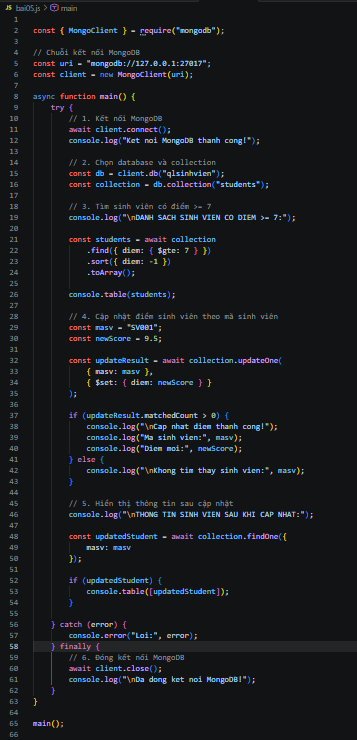
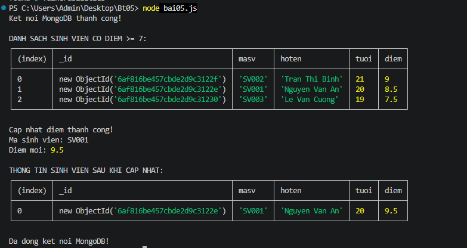

BÀI 05 - TÌM KIẾM, CẬP NHẬT VÀ SẮP XẾP MONGODB
1. Mục tiêu
Kết nối MongoDB bằng Node.js.
Sử dụng database qlsinhvien.
Sử dụng collection students.
Tìm sinh viên có điểm >= 7 bằng find() và $gte.
Sắp xếp điểm giảm dần bằng sort().
Cập nhật điểm bằng updateOne() và $set.
Hiển thị thông tin sinh viên sau khi cập nhật.
2. Công nghệ sử dụng
Node.js
MongoDB
MongoDB Node.js Driver
3. Cài đặt thư viện
bash
npm init -y
npm install mongodb

4. Chạy chương trình
bash

5. Hình ảnh mã nguồn

6. Kết quả chạy chương trình

7. Kiểm tra dữ liệu trong MongoDB
javascript
use qlsinhvien
db.students.find().pretty()

8. Kết luận

Đã hoàn thành bài thực hành tìm kiếm sinh viên có điểm >= 7, sắp xếp điểm giảm dần, cập nhật điểm theo mã sinh viên và hiển thị lại thông tin sau cập nhật bằng MongoDB và Node.js.