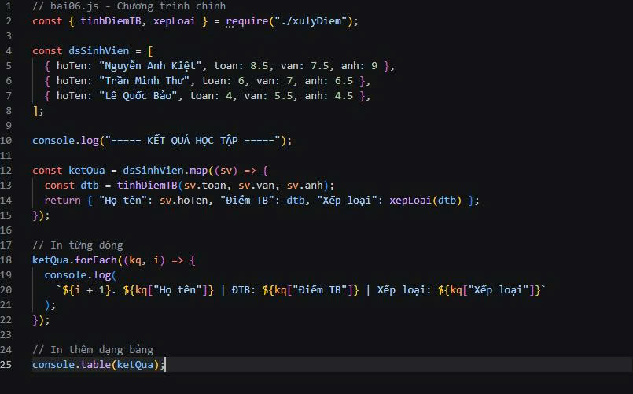
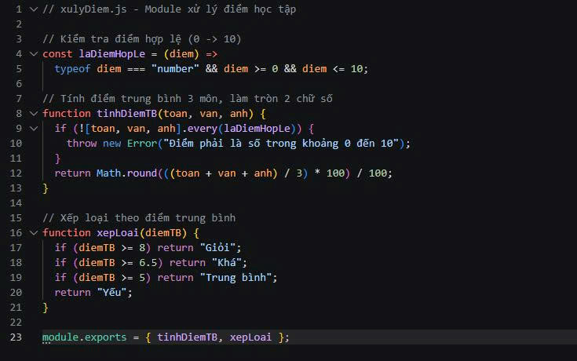
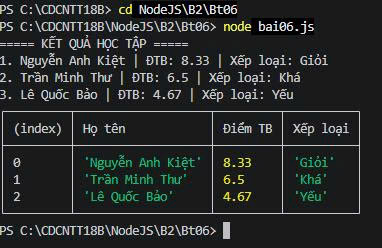

# Bài 6 – Module tính kết quả học tập

## Mô tả
Tách phần tính điểm vào module `xulyDiem.js`. File `bai06.js` gọi module bằng `require()` rồi in họ tên, điểm trung bình và xếp loại của 3 sinh viên.

## Các lệnh thực hiện
```bash
cd NodeJS\B2\Bt06
node bai06.js
```

## Các bước
1. Viết `xulyDiem.js` gồm hai hàm `tinhDiemTB`, `xepLoai`, xuất bằng `module.exports`.

   

2. Viết `bai06.js`, dùng `require("./xulyDiem")` để gọi hàm.

   

3. Chạy chương trình bằng lệnh `node bai06.js`.

   

## Kết quả cuối cùng
| Họ tên | Điểm TB | Xếp loại |
|---|---|---|
| Nguyễn Anh Kiệt | 8.33 | Giỏi |
| Trần Minh Thư | 6.5 | Khá |
| Lê Quốc Bảo | 4.67 | Yếu |