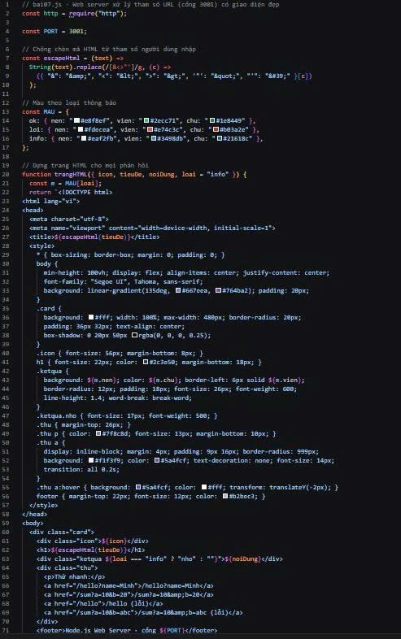
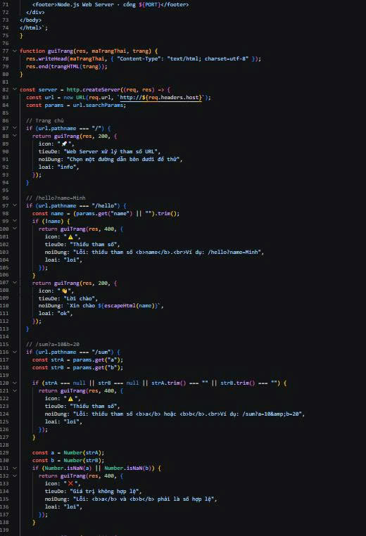
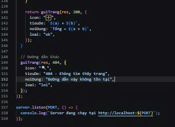
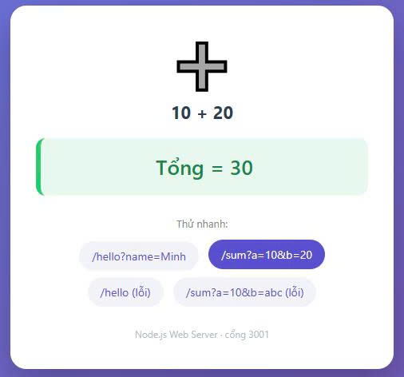
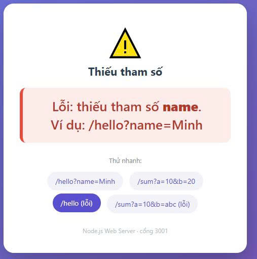

# Bài 7 – Xử lý tham số URL trên Web Server

## Mô tả
Dùng module `http` và đối tượng `URL` để tạo Web Server tại cổng 3001. Server đọc tham số trên đường dẫn, trả kết quả bằng trang HTML có giao diện riêng, và báo lỗi khi thiếu tham số hoặc giá trị không hợp lệ.

## Các lệnh thực hiện
```bash
cd C:\CDCNTT18B\NodeJS-moi\Bai03\Bt07
node bai07.js
```

Sau khi server chạy, mở trình duyệt và truy cập các đường dẫn bên dưới. Nhấn `Ctrl + C` trong Terminal để dừng server.

## Các bước

### Bước 1: Viết code `bai07.js`
Dùng `http.createServer()` và `new URL()` để đọc đường dẫn cùng tham số. Code được chia làm ba phần.

Phần 1:



Phần 2:



Phần 3:



### Bước 2: Chạy server và thử `/hello?name=Minh`
Truy cập `http://localhost:3001/hello?name=Minh`, trang hiển thị **Xin chào Minh**.


### Bước 3: Thử `/sum?a=10&b=20`
Truy cập `http://localhost:3001/sum?a=10&b=20`, trang hiển thị **Tổng = 30**.



### Bước 4: Thử trường hợp thiếu tham số
Truy cập `http://localhost:3001/hello` (không có `name`), trang báo lỗi thiếu tham số.



### Bước 5: Thử trường hợp giá trị không hợp lệ
Truy cập `http://localhost:3001/sum?a=10&b=abc`, trang báo lỗi vì `b` không phải số.


## Kết quả cuối cùng

| Đường dẫn | Kết quả |
|---|---|
| `/hello?name=Minh` | Xin chào Minh |
| `/sum?a=10&b=20` | Tổng = 30 |
| `/hello` | Báo lỗi thiếu tham số `name` |
| `/sum?a=10&b=abc` | Báo lỗi giá trị không hợp lệ |
| Đường dẫn khác | 404 - Không tìm thấy trang |