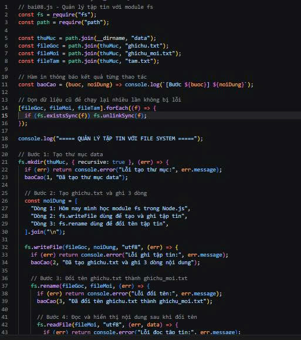
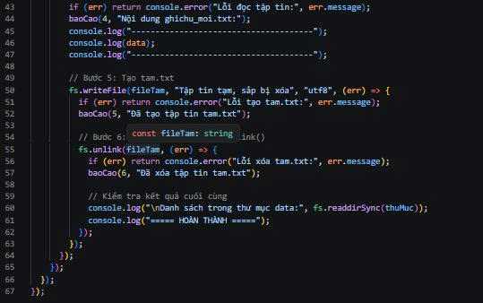
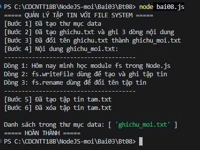
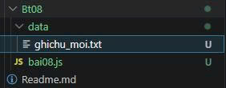
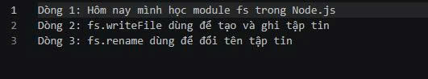

# Bài 8 – Quản lý tập tin với File System

## Mô tả
Dùng module `fs` của Node.js để tạo thư mục, ghi tập tin, đổi tên, đọc nội dung, tạo rồi xóa tập tin tạm. Mỗi thao tác đều có thông báo kết quả trên Terminal.

## Các lệnh thực hiện
```bash
cd C:\CDCNTT18B\NodeJS-moi\Bai03\Bt08
node bai08.js
```

## Các bước

### Bước 1: Viết code `bai08.js`
Dùng các hàm `fs.mkdir`, `fs.writeFile`, `fs.rename`, `fs.readFile`, `fs.unlink`.

Phần 1:



Phần 2:



### Bước 2: Chạy chương trình
Chạy lệnh `node bai08.js`, Terminal in thông báo kết quả từng bước từ Bước 1 đến Bước 6.



### Bước 3: Kiểm tra thư mục data
Thư mục `data` chỉ còn `ghichu_moi.txt`, tập tin `tam.txt` đã bị xóa bằng `fs.unlink()`.



### Bước 4: Nội dung tập tin sau khi đổi tên
Tập tin `ghichu_moi.txt` chứa 3 dòng nội dung đã ghi ở bước tạo tập tin.



## Kết quả cuối cùng

| Thao tác | Hàm sử dụng | Kết quả |
|---|---|---|
| Tạo thư mục `data` | `fs.mkdir()` | Thành công |
| Tạo `ghichu.txt`, ghi 3 dòng | `fs.writeFile()` | Thành công |
| Đổi tên thành `ghichu_moi.txt` | `fs.rename()` | Thành công |
| Đọc và hiển thị nội dung | `fs.readFile()` | Thành công |
| Tạo `tam.txt` | `fs.writeFile()` | Thành công |
| Xóa `tam.txt` | `fs.unlink()` | Thành công |