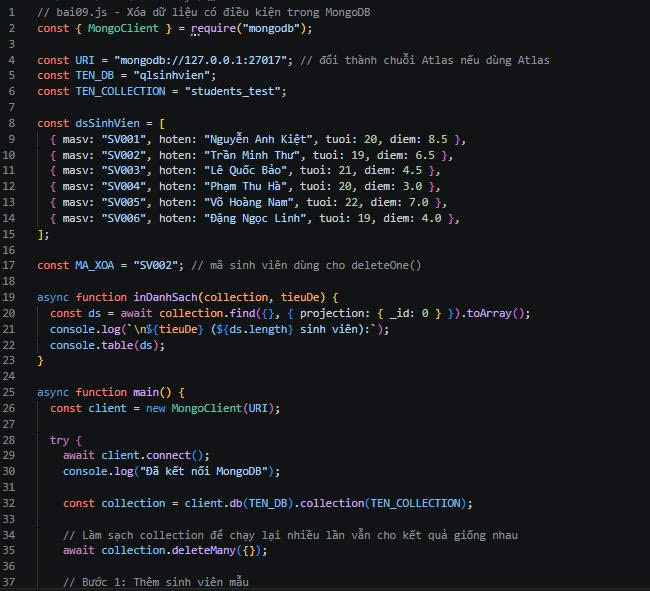
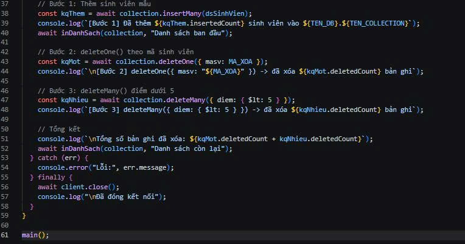
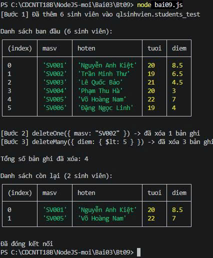
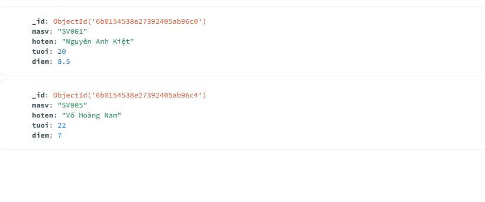

# Bài 9 – Xóa dữ liệu có điều kiện trong MongoDB

## Mô tả
Dùng thư viện `mongodb` kết nối database `qlsinhvien`, collection `students_test`. Thêm sinh viên mẫu, xóa một sinh viên theo mã bằng `deleteOne()`, xóa các sinh viên điểm dưới 5 bằng `deleteMany()`, rồi hiển thị số bản ghi đã xóa và danh sách còn lại bằng `find()`.

## Các lệnh thực hiện
```bash
cd C:\CDCNTT18B\NodeJS-moi\Bai03\Bt09
npm init -y
npm install mongodb
node bai09.js
```

## Các bước

### Bước 1: Cài thư viện và viết code `bai09.js`
Khởi tạo project bằng `npm init -y`, cài thư viện bằng `npm install mongodb`, sau đó viết code `bai09.js`.

Phần 1:



Phần 2:



### Bước 2: Chạy chương trình
Chạy `node bai09.js`: kết nối MongoDB, thêm 6 sinh viên, xóa 1 sinh viên theo mã `SV002`, xóa các sinh viên có điểm dưới 5, rồi in danh sách còn lại.



### Bước 3: Kiểm tra dữ liệu trong MongoDB Compass
Collection `students_test` trong database `qlsinhvien` chỉ còn các sinh viên có điểm từ 5 trở lên.



## Kết quả cuối cùng

| Thao tác | Hàm | Số bản ghi xóa |
|---|---|---|
| Xóa theo mã `SV002` | `deleteOne()` | 1 |
| Xóa điểm dưới 5 | `deleteMany()` | 3 |
| Tổng | | 4 |

Danh sách còn lại: SV001 (Nguyễn Anh Kiệt, 8.5) và SV005 (Võ Hoàng Nam, 7.0).