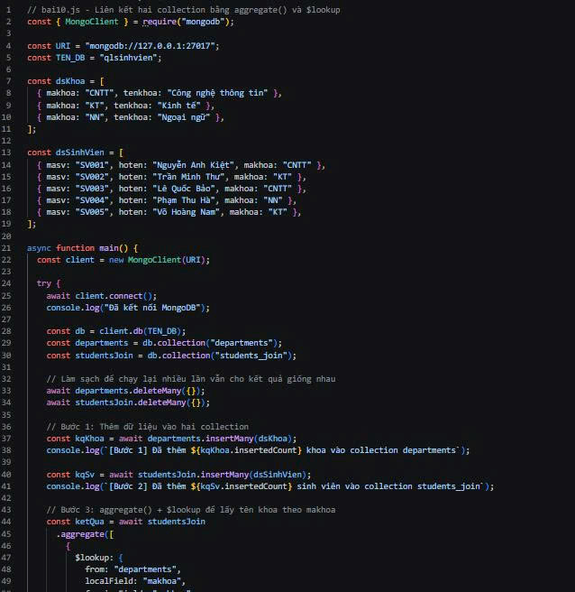
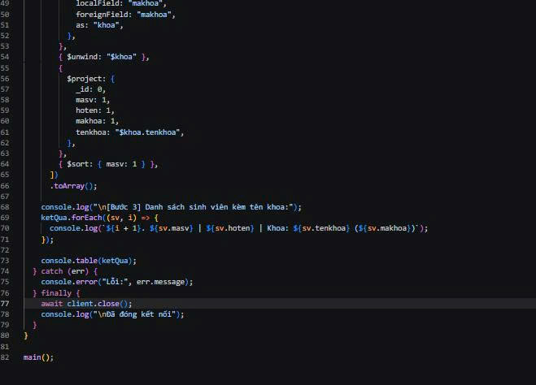
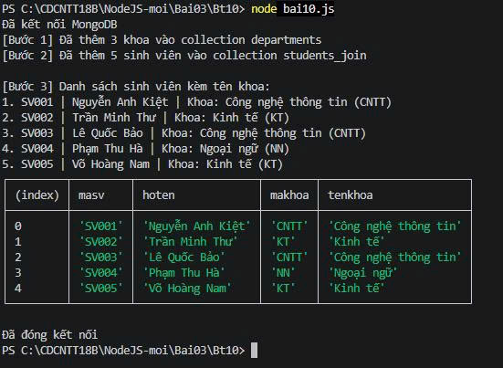
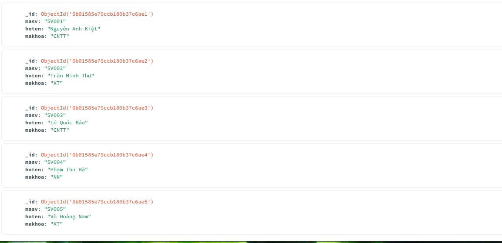

# Bài 10 – Liên kết hai Collection trong MongoDB

## Mô tả
Tạo hai collection `departments` (khoa) và `students_join` (sinh viên) trong database `qlsinhvien`. Dùng `aggregate()` kết hợp `$lookup` để liên kết sinh viên với khoa qua trường `makhoa`, hiển thị danh sách sinh viên kèm tên khoa.

## Các lệnh thực hiện
```bash
cd C:\CDCNTT18B\NodeJS-moi\Bai03\Bt10
npm init -y
npm install mongodb
node bai10.js
```

## Các bước

### Bước 1: Cài thư viện và viết code `bai10.js`
Phần 1:



Phần 2:



### Bước 2: Chạy chương trình
Chạy `node bai10.js`: thêm 3 khoa và 5 sinh viên, sau đó dùng `$lookup` lấy tên khoa cho từng sinh viên.



### Bước 3: Kiểm tra dữ liệu trong MongoDB Compass
Hai collection `departments` và `students_join` đã được tạo trong database `qlsinhvien`.



## Kết quả cuối cùng

| Mã SV | Họ tên | Mã khoa | Tên khoa |
|---|---|---|---|
| SV001 | Nguyễn Anh Kiệt | CNTT | Công nghệ thông tin |
| SV002 | Trần Minh Thư | KT | Kinh tế |
| SV003 | Lê Quốc Bảo | CNTT | Công nghệ thông tin |
| SV004 | Phạm Thu Hà | NN | Ngoại ngữ |
| SV005 | Võ Hoàng Nam | KT | Kinh tế |

Kết quả hiển thị đầy đủ tên khoa, không chỉ mã khoa.