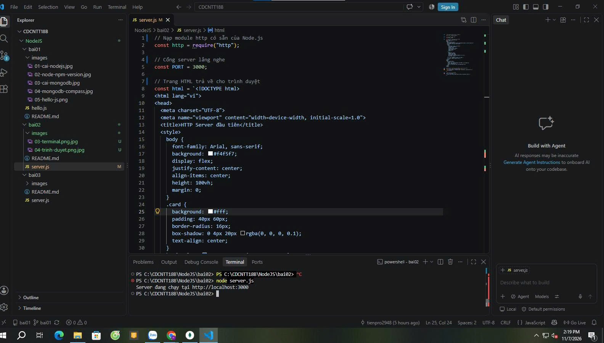
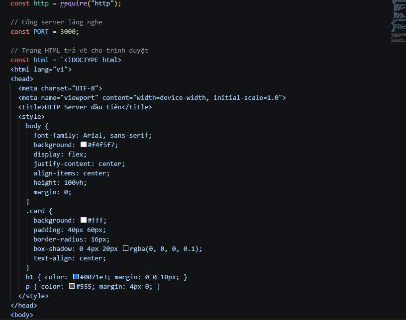
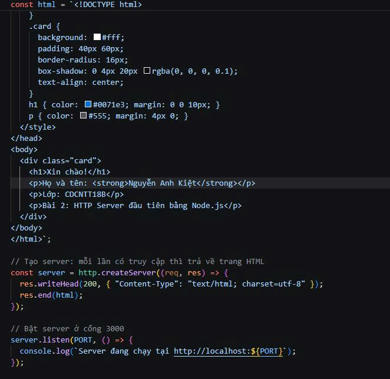
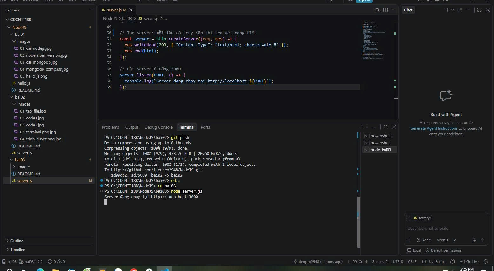
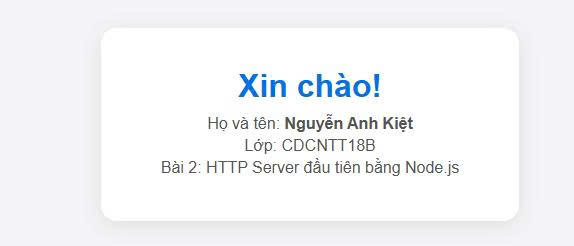

# Bài 2 — HTTP Server đầu tiên

Sinh viên: Nguyễn Anh Kiệt | Mã SV: CDCNTT18B14 | Lớp: CDCNTT18B

## 1. Yêu cầu
Tạo HTTP server bằng Node.js thuần (module `http`); truy cập `localhost:3000` và trả về trang HTML chứa tên sinh viên. Đẩy mã nguồn lên GitHub.

## 2. Tạo thư mục và file
Tạo thư mục `bai02`, trong đó tạo file `server.js`.



## 3. Mã nguồn `server.js`
```javascript
// Nạp module http có sẵn của Node.js
const http = require("http");

// Cổng server lắng nghe
const PORT = 3000;

// Trang HTML trả về cho trình duyệt
const html = `<!DOCTYPE html>
<html lang="vi">
<head>
  <meta charset="UTF-8">
  <meta name="viewport" content="width=device-width, initial-scale=1.0">
  <title>HTTP Server đầu tiên</title>
  <style>
    body {
      font-family: Arial, sans-serif;
      background: #f4f5f7;
      display: flex;
      justify-content: center;
      align-items: center;
      height: 100vh;
      margin: 0;
    }
    .card {
      background: #fff;
      padding: 40px 60px;
      border-radius: 16px;
      box-shadow: 0 4px 20px rgba(0, 0, 0, 0.1);
      text-align: center;
    }
    h1 { color: #0071e3; margin: 0 0 10px; }
    p { color: #555; margin: 4px 0; }
  </style>
</head>
<body>
  <div class="card">
    <h1>Xin chào!</h1>
    <p>Họ và tên: <strong>Nguyễn Anh Kiệt</strong></p>
    <p>Lớp: CDCNTT18B</p>
    <p>Bài 2: HTTP Server đầu tiên bằng Node.js</p>
  </div>
</body>
</html>`;

// Tạo server: mỗi lần có truy cập thì trả về trang HTML
const server = http.createServer((req, res) => {
  res.writeHead(200, { "Content-Type": "text/html; charset=utf-8" });
  res.end(html);
});

// Bật server ở cổng 3000
server.listen(PORT, () => {
  console.log(`Server đang chạy tại http://localhost:${PORT}`);
});
```

Phần đầu file:



Phần sau file:



## 4. Chạy server
Mở Terminal tại thư mục `bai02`, chạy lệnh:
```
node server.js
```
Terminal hiện: `Server đang chạy tại http://localhost:3000`



## 5. Kết quả trên trình duyệt
Mở `http://localhost:3000`, trang hiển thị họ tên và lớp của sinh viên.



Dừng server: nhấn `Ctrl + C` trong Terminal.