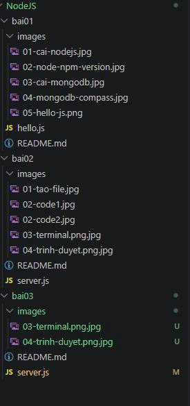
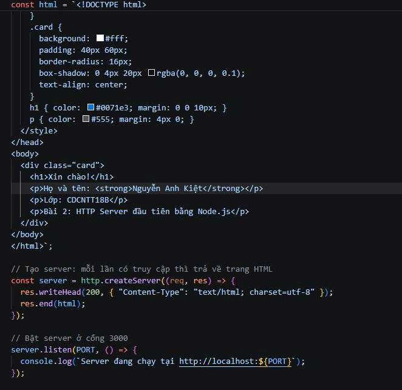

# Bài 3 — Ứng dụng Node.js đầu tiên

Sinh viên: Nguyễn Anh Kiệt | Mã SV: CDCNTT18B14 | Lớp: CDCNTT18B

## 1. Yêu cầu
Tạo ứng dụng Node.js sử dụng module `http`. Server chạy tại cổng 3000. Khi truy cập trang chủ, trả về HTML có họ tên và mã sinh viên. Nộp liên kết GitHub và mô tả cách chạy.

## 2. Cách chạy

**Yêu cầu:** đã cài Node.js (v24.15.0).

1. Mở thư mục `bai03` trong VS Code.



2. Tạo file `server.js` dùng module `http`, lắng nghe cổng 3000. Họ tên và mã sinh viên được khai báo ở đầu file.

Phần đầu file:


Phần sau file:



3. Mở Terminal tại thư mục `bai03`, chạy lệnh:
```
node server.js
```
Terminal hiện: `Server đang chạy tại http://localhost:3000`


4. Mở trình duyệt, truy cập `http://localhost:3000`


## 3. Kết quả
Trang web hiển thị họ tên Nguyễn Anh Kiệt, mã sinh viên CDCNTT18B14 và lớp CDCNTT18B.

Dừng server: nhấn `Ctrl + C` trong Terminal.